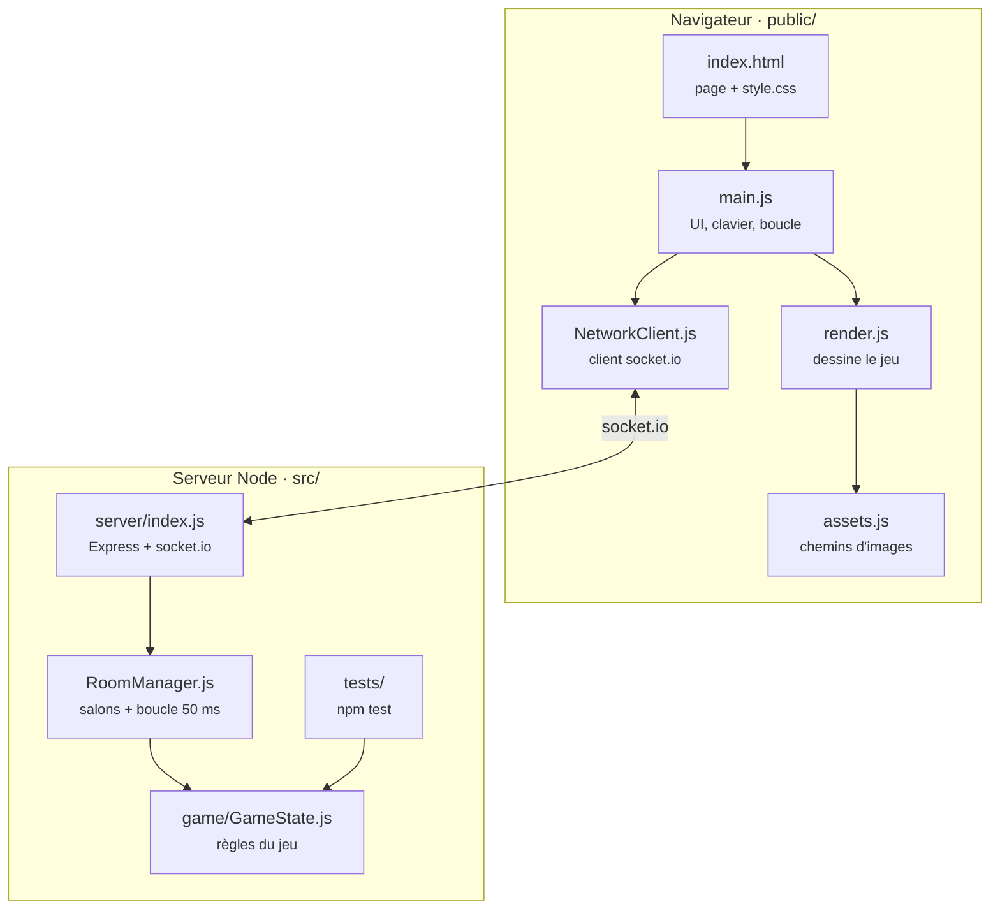

# Grenoble Bomber

- `npm start` lance le serveur sur http://localhost:3000.
- `npm test` teste `src/game/GameState.js`.

## Architecture

Deux programmes séparés qui ne se parlent que par socket.io :
le **serveur** (`src/`) applique toutes les règles, le **client** (`public/`) affiche l'état reçu et envoie les touches.

Équipe : Tasnim ZAHOUANI, Zemiao HU, Rachel PERETTI, Gatien CAILLET, Ziyang GU.
